# 三十三个引理:形式化表达、数理图像与依赖 DAG

> **对象**:`repos/godcore/lean-boundary/BoundaryTheory.lean`(928 行,仓库内唯一 `.lean` 文件)
> **方法**:程序化剥离注释后,逐声明提取 **类型签名**(到 `:=` 为止)与 **证明体**,再对同文件
> 内声明名做全词匹配得到依赖边。**不使用文档转述,不依赖肉眼看。**
> **立档**:梁西克/DSH · 2026-09-11 · 行号以本机审计版(sha256 `4f63b1e4…`)为准
> **配套**:`重建说明_verify_event_boundary_20260911.md`(公差留档)

---

## 零、这份文档要解决什么

前面两份稿子都把 33 条声明当作**一个数字**(「33 个定理与引理」)来引用。这是浪费。

这 33 条不是并列的 33 个事实,它们是**一棵树**:7 个定义在上游,1 条定理在下游,中间有明确的
依赖结构、三种不同的证明技术、以及一条**与另外 21 条几乎不相连的支链**(值链)。

本文做四件事:

1. 给出**每一层**的数理图像(这一层在讲什么物理/几何故事);
2. 给出**每一条**的 Lean 类型签名(形式化表达,逐字照抄)与它的数学读法;
3. 给出**依赖 DAG**(机器提取的边,不是画的示意图);
4. 标出**结构病点**:哪些地方依赖是"薄的",哪些是被刻意拉长的。

---

## 一、总图:33 条声明分五层

```
第 0 层  7 个 def            V, kappaStar, sigmaStar, force, hbin, sig, entropyDensity
   │
   ├──────────────┬──────────────────────┬─────────────────────┐
   ▼              ▼                      ▼                     ▼
第 1 层       第 2 层                第 3 层               第 4 层
势与力         收敛语料               值链(级数侧)         值链(积分侧)
(8 条)         (13 条)                (5 条)                (7 条)
kappaStar_sq   hbin_symm              integral_pow_zero_one  sig_hasDerivAt
kappaStar_bal  sig_neg                tsum_inv_succ_sq…      sig_continuous
deriv_V_kappa  entropyDensity_even    integral_pow_mul_log…  tendsto_sig_atBot…
sigmaStar_gen  sig_pos                neg_log_div_one_sub…   tendsto_sig_atTop…
sigmaStar_iff  sig_lt_one             integral_neg_log…      hbin_div_contOn
sigmaStar_one  hbin_nonneg                                   entropyDensity_integral…
force_is_neg_g  entropyDensity_nonneg
energy_bracket  neg_log_one_sub_le_div
                neg_q_mul_log_q_le
                entropyDensity_decay_of_nonneg
                entropyDensity_decay
                entropyDensity_continuous
                boundary_entropy_integrable
```

**一眼能看出的第一件事**:第 1 层(势与力,8 条)与第 2–4 层(熵与积分,25 条)
**几乎不共享任何中间结果**。它们唯一的共同祖先,是"文件里同时定义了 $V$ 和 $h,\sigma$"这件事本身。这条"结构缝隙"从第一天就在,后面第六章会说明它的后果。

---

## 二、第 1 层:势与力(8 条)

### 数理图像

这一层讲的是一个**两笔账的极小值问题**。

$$
V(\kappa)=c_0\kappa+\frac{\alpha\pi^2}{3\kappa}
$$

左项随 $\kappa$ 线性上涨(维持一条锐边界要持续做功),右项随 $\kappa$ 反比下降(边界越锐,
它"糊掉"的熵越少)。两条曲线一升一降,交点处就是极小值。

**这一层的全部内容,就是把这张图画清楚,并且说清楚"极小值点在哪"和"那一点上两笔账相等"。**

```
 cost
   │  ╲                     ╱  απ²/(3κ)  模糊的价钱
   │   ╲                   ╱
   │    ╲                 ╱
   │     ╲_______________╱   ← 交点:两笔账相等(均分)
   │      ╲             ╱
   │       ╲           ╱
   │  c₀κ   ╲_________╱
   │          ╲     ╱
   └───────────●──────────────────► κ
              κ* = √(αC_F/c₀)
```

### 第 0 层自身也是一张 DAG

七个定义不是并列的。`entropyDensity` 是**用前面两个定义搭出来的**:

```
def hbin (p : ℝ) : ℝ := -p * Real.log p - (1 - p) * Real.log (1 - p)
def sig  (z : ℝ) : ℝ := 1 / (1 + Real.exp (-z))
def entropyDensity (z : ℝ) : ℝ := hbin (sig z)      ← 两个定义指向它

  hbin ──┐
         ├──▶ entropyDensity
  sig  ──┘
```

**这条两边的定义内边,是"把熵与归属场复合起来"这一动作的形式化痕迹。** 全篇那句
「边界熵密度 $z\mapsto h(\sigma(z))$」在 Lean 里就是这一行 `def`。

另外四个定义(`V`、`kappaStar`、`sigmaStar`、`force`)彼此独立,只引用实数与 `Real.pi`。

### 逐条

| #   | 声明                      | 行   | Lean 类型签名(逐字)                                                                  | 数学读法                                                                        | 依赖                               |
| --- | ----------------------- | --- | ------------------------------------------------------------------------------ | --------------------------------------------------------------------------- | -------------------------------- |
| —   | `def V`                 | 30  | `def V (c₀ α : ℝ) (κ : ℝ) : ℝ`                                                 | $V(\kappa)=c_0\kappa+\frac{\alpha\pi^2}{3\kappa}$                           | —                                |
| —   | `def kappaStar`         | 33  | `def kappaStar (c₀ α : ℝ) : ℝ`                                                 | $\kappa^*=\pi\sqrt{\alpha/(3c_0)}$                                          | —                                |
| —   | `def sigmaStar`         | 36  | `def sigmaStar (α C₀ : ℝ) : ℝ`                                                 | $\sigma^*=\pi^2\alpha/(3C_0)$                                               | —                                |
| —   | `def force`             | 39  | `def force (c₀ α : ℝ) (κ : ℝ) : ℝ`                                             | $F(\kappa)=\alpha\pi^2/(3\kappa^2)-c_0$                                     | —                                |
| 1   | `kappaStar_sq`          | 43  | `(hc₀ : 0 < c₀) (hα : 0 ≤ α) : (kappaStar c₀ α)^2 = π^2 * α / (3 * c₀)`        | **$\kappa^{*2}=\pi^2\alpha/(3c_0)$**。把定义的平方算出来——一切从这条开始                     | `kappaStar`                      |
| 2   | `kappaStar_balance`     | 51  | `(hc₀ : 0 < c₀) (hα : 0 < α) : c₀ = α * π^2 / (3 * (kappaStar c₀ α)^2)`        | **均分定理**:$c_0=\dfrac{\alpha\pi^2}{3\kappa^{*2}}$。左端是维持单价,右端是模糊单价——**两笔账相等** | `kappaStar`, `kappaStar_sq`      |
| 3   | `deriv_V_kappaStar`     | 58  | `(hc₀ : 0 < c₀) (hα : 0 < α) : deriv (fun κ => V c₀ α κ) (kappaStar c₀ α) = 0` | **$V'(\kappa^*)=0$**。这是"最小作用"的**真正形式**——注意:它是定理,不是公理                        | `V`, `kappaStar`, `kappaStar_sq` |
| 4   | `sigmaStar_general`     | 77  | `(α C₀ : ℝ) : sigmaStar α C₀ = π^2 * α / (3 * C₀)`                             | **一般律**:$\sigma^*=\pi^2\alpha/(3C_0)$。**无任何前提假设**                           | `sigmaStar`                      |
| 5   | `sigmaStar_eq_one_iff`  | 82  | `(α C₀ : ℝ) (hC₀ : C₀ ≠ 0) : sigmaStar α C₀ = 1 ↔ π^2 * α = 3 * C₀`            | **无量纲判据**:$\sigma^*=1\iff\pi^2\alpha=3C_0$。**这是全文唯一可直接拿去做实验的判据**            | `sigmaStar`, `sigmaStar_general` |
| 6   | `sigmaStar_eq_one`      | 95  | `(hC₀ : C₀ ≠ 0) : sigmaStar (3 * C₀ / π^2) C₀ = 1`                             | **规范值**:取 $\alpha=3C_0/\pi^2$ 时 $\sigma^*=1$。一般律代入的特例                       | `sigmaStar`, `sigmaStar_general` |
| 7   | `force_is_neg_gradient` | 102 | `(c₀ α κ : ℝ) : force c₀ α κ = -(c₀ - α * π^2 / (3 * κ^2))`                    | **$F=-\nabla V$**。广义力就是势的负梯度                                                | `force`                          |
| 8   | `energy_bracket_zero`   | 108 | `(c₀ α κ : ℝ) : force c₀ α κ + (c₀ - α * π^2 / (3 * κ^2)) = 0`                 | **$F+V'=0$**。Noether 守恒的代数芯:$dE/dt=\dot\kappa(F+V')=0$                      | `force`                          |

### 这一层的三个可教之处

**(1) 依赖是"薄"的,这是好事。** 8 条里最长的依赖链只有 3 步(`kappaStar_sq → kappaStar_balance → deriv_V_kappaStar`)。薄依赖 = **易读** = 一个高中生可以在一个下午内把这一层全部读懂并手算验证。

**(2) `deriv_V_kappaStar` 是整份形式化的"道德中心"。** 论文原来的第五条公理写的是"边界停在 $V'(\kappa^*)=0$ 处"。而这里它是一条**定理**(第 58 行),前提只有 $c_0>0$、$\alpha>0$。**"最小作用"这个概念没有付出任何假设代价。**

**(3) 第 5 条的 `↔` 是全文最有价值的符号。** 一个双向蕴含意味着:你可以**从实验测得的 $\sigma$ 反推 $\alpha/C_0$ 的比例**,也可以从参数正推临界点。这是"可证伪"的技术含义。

---

## 三、第 2 层:熵与可积性(13 条)

### 数理图像

这一层讲的是**一条边界"有多糊"**,以及**这个"糊量"能不能被积分**。

$$
h(p)=-p\ln p-(1-p)\ln(1-p),\qquad \sigma(z)=\frac{1}{1+e^{-z}},\qquad g(z)=h\big(\sigma(z)\big)
$$

$g(z)$ 的图像是一座**倒 U 形的钟**,峰在 $z=0$、高 $\ln 2\approx0.693$,两侧指数衰减:

```
 g(z)
  0.693 ┤      ▄▄███▄▄
        │    ▄█████████▄
        │   █████████████
        │  ███████████████
        │ █████████████████
        │███████████████████
        │█████████████████████
      0 └──────┬──────────┬───────► z
             -4      0       +4
              ╲                ╱
               ╲__  ~3e^{-|z|/2}  ← 指数衰减,这是可积性的全部依据
```

**这一层要证明的就两件事:① 这座钟非负、连续、偶对称;② 它衰减得足够快,所以整条边界上的
"糊量"加起来是个有限数。**

### 逐条

| #   | 声明                               | 行   | Lean 类型签名(逐字)                                                             | 数学读法                                                      | 依赖                                                               |
| --- | -------------------------------- | --- | ------------------------------------------------------------------------- | --------------------------------------------------------- | ---------------------------------------------------------------- |
| 9   | `hbin_symm`                      | 129 | `(p : ℝ) : hbin (1 - p) = hbin p`                                         | $h(1-p)=h(p)$:熵对"我/非我"互换对称                                | `hbin`                                                           |
| 10  | `sig_neg`                        | 134 | `(z : ℝ) : sig (-z) = 1 - sig z`                                          | $\sigma(-z)=1-\sigma(z)$:归属场的镜像反对称                        | `sig`                                                            |
| 11  | `entropyDensity_even`            | 141 | `(z : ℝ) : entropyDensity (-z) = entropyDensity z`                        | $g$ 是**偶函数**。前两条的合成                                       | `entropyDensity`, `hbin_symm`, `sig_neg`                         |
| 12  | `sig_pos`                        | 148 | `(z : ℝ) : 0 < sig z`                                                     | $0<\sigma(z)$:归属分数不为零                                     | `sig`                                                            |
| 13  | `sig_lt_one`                     | 152 | `(z : ℝ) : sig z < 1`                                                     | $\sigma(z)<1$:归属分数不为一                                     | `sig`                                                            |
| 14  | `hbin_nonneg`                    | 158 | `(p : ℝ) (hp0 : 0 < p) (hp1 : p < 1) : 0 ≤ hbin p`                        | 熵非负(在开区间上)                                                | `hbin`                                                           |
| 15  | `entropyDensity_nonneg`          | 168 | `(z : ℝ) : 0 ≤ entropyDensity z`                                          | **$g(z)\ge0$**:密度非负。把 12–14 三条拼起来                         | `entropyDensity`, `hbin_nonneg`, `sig`, `sig_lt_one`, `sig_pos`  |
| 16  | `neg_log_one_sub_le_div`         | 173 | `(q : ℝ) (_hq0 : 0 ≤ q) (hq1 : q < 1) : -Real.log (1-q) ≤ q/(1-q)`        | **对数界 I**:$-\ln(1-q)\le q/(1-q)$。估计右尾的工具                  | —                                                                |
| 17  | `neg_q_mul_log_q_le`             | 185 | `(q : ℝ) (hq0 : 0 < q) (hq1 : q ≤ 1) : -q * Real.log q ≤ 2 * Real.sqrt q` | **对数界 II**:$-q\ln q\le2\sqrt q$。估计左尾的工具                   | —                                                                |
| 18  | `entropyDensity_decay_of_nonneg` | 213 | `(hz : 0 ≤ z) : entropyDensity z ≤ 3 * Real.exp (-(1/2) * z)`             | **半轴指数衰减**:$g(z)\le3e^{-z/2}$($z\ge0$)                    | `entropyDensity`, `hbin`, 16, 17, `sig`, `sig_lt_one`, `sig_pos` |
| 19  | `entropyDensity_decay`           | 266 | `(z : ℝ) : entropyDensity z ≤ 3 * Real.exp (-\|z\|/2)`                    | **双侧指数衰减**:$g(z)\le3e^{-\lvert z\rvert/2}$。偶性把半轴推广到全轴     | `entropyDensity`, 18, 11                                         |
| 20  | `entropyDensity_continuous`      | 282 | `: Continuous entropyDensity`                                             | **连续性**                                                   | `entropyDensity`, `hbin`, `sig`, `sig_lt_one`, `sig_pos`         |
| 21  | `boundary_entropy_integrable`    | 313 | `: MeasureTheory.Integrable entropyDensity`                               | **可积性**:$\int_{\mathbb R}g<\infty$。**这条是 $C_H$ 良定义的全部前提** | `entropyDensity`, 20, 18, 11, 15                                 |

### 这一层的关键结构

**两条对数界(16、17)是无祖先的。** 它们是纯粹的初等不等式,$-\ln(1-q)\le q/(1-q)$ 和
$-q\ln q\le2\sqrt q$——**高中水平就能验证**。但整个可积性大厦架在这两块砖上:

```
16 ─┐
17 ─┴─→ 18(半轴衰减) ─→ 19(双侧衰减) ─┐
11(偶性) ────────────────────────────┼─→ 21(可积) ─→ [第 4 层]
15(非负) ────────────────────────────┤
20(连续) ────────────────────────────┘
```

**这就是数理分析最典型的"图像"**:一个看起来无害的积分,要证明它有意义,必须回到
$q\to1$ 和 $q\to0$ 两个端点的**局部行为**上去。而这两个端点行为,恰好对应边界的两侧:

| 端点                     | 数学                  | 物理                     |
| ---------------------- | ------------------- | ---------------------- |
| $q\to0$($z\to-\infty$) | $-q\ln q\to0$ 但导数发散 | 非我侧:归属趋于零,但**趋近方式含对数** |
| $q\to1$($z\to+\infty$) | $-\ln(1-q)$ 发散      | 自我侧:归属趋于一,同样是对数趋近      |

**"两侧都是对数趋近"这件事,正是第四章那条"对数奇点"的来源。**

---

## 四、第 3 层:值链的级数侧(5 条)

### 数理图像

这一层是**从"连续积分"到"离散求和"的桥**。

$$
\int_0^1\frac{-\ln p}{1-p}\,dp\ \xrightarrow{\ p^n\ \text{展开}\ }\ \sum_{n\ge0}\int_0^1p^n(-\ln p)\,dp
\ \xrightarrow{\ \text{分部积分}\ }\ \sum_{n\ge0}\frac{1}{(n+1)^2}=\frac{\pi^2}{6}
$$

图像是一条**逐层分解的阶梯**:把一条连续曲线,拆成无穷多个"层"的贡献,每一层的权重是
$1/(n+1)^2$。收敛极快——**第一层就占 60.8%**。

### 逐条

| #   | 声明                                      | 行   | Lean 类型签名(逐字)                                                                         | 数学读法                                                      | 依赖         |
| --- | --------------------------------------- | --- | ------------------------------------------------------------------------------------- | --------------------------------------------------------- | ---------- |
| 22  | `integral_pow_zero_one`                 | 342 | `(n : ℕ) : ∫ x in (0:ℝ)..1, (x:ℝ)^n = 1/((n:ℝ)+1)`                                    | $\int_0^1x^n dx=\frac1{n+1}$。幂积分锚点                        | —          |
| 23  | `tsum_inv_succ_sq_eq_pi_sq_div_six`     | 365 | `: (∑' n : ℕ, (1:ℝ)/((n:ℝ)+1)^2) = π^2/6`                                             | **巴塞尔,重标号**:$\sum_{n\ge0}\frac1{(n+1)^2}=\frac{\pi^2}{6}$ | —          |
| 24  | `integral_pow_mul_log_zero_one`         | 402 | `(n : ℕ) : ∫ x in (0:ℝ)..1, (x:ℝ)^n * Real.log x = -1/((n:ℝ)+1)^2`                    | **幂–对数主积分**:$\int_0^1x^n\ln x\,dx=-\frac1{(n+1)^2}$       | —          |
| 25  | `neg_log_div_one_sub_eq_tsum`           | 489 | `{x : ℝ} (hx : x ∈ Set.uIcc 0 1) : -Real.log x/(1-x) = ∑' n : ℕ, x^n * (-Real.log x)` | **逐点几何级数展开**:$\frac{-\ln x}{1-x}=\sum x^n(-\ln x)$        | —          |
| 26  | `integral_neg_log_div_one_sub_zero_one` | 508 | `: ∫ x in (0:ℝ)..1, -Real.log x/(1-x) = π^2/6`                                        | **级数–积分交换**:右端 $=\pi^2/6$                                 | 24, 25, 23 |

### 这一层最关键的一件事:第 26 条为什么要三块砖

`integral_neg_log_div_one_sub_zero_one` 的依赖是 `[24, 25, 23]`——三块**全部无祖先**的砖:

```
24(幂–对数)  ─┐
25(级数展开)  ─┼─→ 26(积分 = π²/6)
23(巴塞尔)    ─┘
```

这三块砖各自独立,**没有一条依赖前面任何东西**。这在结构上是**刻意**的:因为第 25 条
的等比级数在 $[0,1]$ 上**不一致收敛**(级数在 $x\to1^-$ 处发散),高中课本的定理在这里
**不够用**。所以机器证明必须换成**控制收敛定理**,而控制收敛需要:

- 24:每一项的可积性与显式值;
- 23:尾和控制——$\sum\int|p^n\ln p|=\sum\frac1{(n+1)^2}=\frac{\pi^2}{6}<\infty$;
- 25:逐点收敛。

**一块砖都不能少。** 这就是第四章那句"数学里最危险的一步,往往也是最值钱的一步"的
**形式化证据**。

---

## 五、第 4 层:值链的积分侧(7 条)与终点

### 数理图像

这一层把第 2 层的"熵密度 $g$"和第 3 层的"级数"**缝在一起**。缝合的针脚是 **logit 换元**:

$$
p=\sigma(z),\qquad \frac{dp}{dz}=p(1-p)\ \Longrightarrow\ dz=\frac{dp}{p(1-p)}
$$

```
       z 轴                       p 轴
  ┌──────────────┐          ┌──────────────┐
  │  g(z) 的钟形 │  ──换元──▶ │ h(p)/(p(1-p)) │
  │  ∫_ℝ g dz    │          │  2∫_0^1 …dp   │
  └──────────────┘          └──────────────┘
        ↑                          ↑
   第 2 层(可积性)            第 3 层(级数 = π²/6)
        └────────── 拼成 C_H = π²/3 ──────────┘
```

### 逐条

| #   | 声明                                                        | 行   | Lean 类型签名(逐字)                                                              | 数学读法                                     | 依赖                       |
| --- | --------------------------------------------------------- | --- | -------------------------------------------------------------------------- | ---------------------------------------- | ------------------------ |
| 27  | `sig_hasDerivAt`                                          | 618 | `(z : ℝ) : HasDerivAt sig (sig z * (1 - sig z)) z`                         | **换元的雅可比**:$\sigma'(z)=\sigma(1-\sigma)$ | `sig`                    |
| 28  | `sig_continuous`                                          | 641 | `: Continuous sig`                                                         | $\sigma$ 连续(换元的正则性)                      | `sig`                    |
| 29  | `tendsto_sig_atBot_nhds_zero`                             | 651 | `: Filter.Tendsto sig Filter.atBot (nhds 0)`                               | 左端点:$\sigma(z)\to0$($z\to-\infty$)       | `sig`                    |
| 30  | `tendsto_sig_atTop_nhds_one`                              | 662 | `: Filter.Tendsto sig Filter.atTop (nhds 1)`                               | 右端点:$\sigma(z)\to1$($z\to+\infty$)       | `sig`                    |
| 31  | `hbin_div_contOn`                                         | 673 | `: ContinuousOn (fun p => hbin p / (p * (1 - p))) (Set.Ioo 0 1)`           | 被积函数在开区间上连续                              | `hbin`                   |
| 32  | `entropyDensity_integral_eq_two_mul_integral_neg_log_div` | 696 | `: (∫ z : ℝ, entropyDensity z) = 2 * (∫ p in (0:ℝ)..1, -Real.log p/(1-p))` | **logit 换元 + 镜像对称**:整轴积分 = 2 × 半轴积分      | 见下(13 个依赖)               |
| 33  | `C_H_eq_pi_sq_div_three`                                  | 923 | `: (∫ z : ℝ, entropyDensity z) = π^2/3`                                    | **终点**:边界熵常数 $C_H=\pi^2/3$               | `entropyDensity`, 32, 26 |

### 第 32 条:全文依赖最重的一条

它的依赖集是 13 个:

```
boundary_entropy_integrable, entropyDensity, hbin, hbin_div_contOn, hbin_nonneg,
sig, sig_continuous, sig_hasDerivAt, sig_lt_one, sig_neg, sig_pos,
tendsto_sig_atBot_nhds_zero, tendsto_sig_atTop_nhds_one
```

**这不是坏事,这是"缝合点"的必然特征。** 换元定理要求:被积函数在两端有极限(29、30)、
在内部连续(31)、原积分收敛(21)、雅可比处处存在(27)。**缺一条,缝合就不成立。**

### 第 33 条:为什么它离前一条有 227 行

```
第 32 行 696 ────────────────────────────────► 第 33 行 923
                    227 行(全是注释与策略说明)
```

这 227 行里**没有新的数学**——它是 Stage 4 的"拼接":一行重写加 `ring`。**行距不代表难度,
行距代表解释。**

---

## 六、依赖 DAG(机器提取)

下面是**从证明体全词匹配**得到的边(不是示意图)。为可读性,按"定义 → 定理"两个层次绘制。

### 6.1 主线 DAG

```mermaid
%% 由脚本从证明体机器提取：节点 40、边 72；与真值边集逐边比对，缺 0 多 0
flowchart TD
  classDef defn fill:#eef3ff,stroke:#5577bb,stroke-width:1px;
  classDef base fill:#fff8e1,stroke:#c9a227,stroke-width:1px;
  classDef thm fill:#f3fff3,stroke:#3d8b3d,stroke-width:1px;
  classDef star fill:#e8f0ff,stroke:#2f6fb5,stroke-width:1.5px;
  classDef end_ fill:#ffe9e9,stroke:#c0392b,stroke-width:2px;
  subgraph L0["第 0 层 · 七个定义"]
    V["V"]
    kappaStar["kappaStar"]
    sigmaStar["sigmaStar"]
    force["force"]
    hbin["hbin"]
    sig["sig"]
    entropyDensity["entropyDensity"]
  end
  subgraph L1["第 1 层 · 势与力"]
    kappaStar_s["kappaStar_sq · L43"]
    kappaStar_b["kappaStar_balance · L51"]
    de["deriv_V_kappaStar · L58"]
    sigmaStar_g["sigmaStar_general · L77"]
    sigmaStar_eq_one_["sigmaStar_eq_one_iff · L82"]
    sigmaStar_eq_one["sigmaStar_eq_one · L95"]
    force_["force_is_neg_gradient · L102"]
    ene["energy_bracket_zero · L108"]
  end
  subgraph L2["第 2 层 · 熵与可积性"]
    hbin_s["hbin_symm · L129"]
    sig_n["sig_neg · L134"]
    entropyDensity_e["entropyDensity_even · L141"]
    sig_p["sig_pos · L148"]
    sig_l["sig_lt_one · L152"]
    hbin_n["hbin_nonneg · L158"]
    entropyDensity_n["entropyDensity_nonneg · L168"]
    neg_log_o["neg_log_one_sub_le_div · L173"]
    neg_q["neg_q_mul_log_q_le · L185"]
    entropyDensity_decay_["entropyDensity_decay_of_nonneg · L213"]
    entropyDensity_decay["entropyDensity_decay · L266"]
    entropyDensity_c["entropyDensity_continuous · L282"]
    bo["boundary_entropy_integrable · L313"]
  end
  subgraph L3["第 3 层 · 值链级数侧"]
    integral_pow_z["integral_pow_zero_one · L342"]
    ts["tsum_inv_succ_sq_eq_pi_sq_div_six · L365"]
    integral_pow_m["integral_pow_mul_log_zero_one · L402"]
    neg_log_d["neg_log_div_one_sub_eq_tsum · L489"]
    integral_n["integral_neg_log_div_one_sub_zero_one · L508"]
  end
  subgraph L4["第 4 层 · 值链积分侧与终点"]
    sig_h["sig_hasDerivAt · L618"]
    sig_c["sig_continuous · L641"]
    tendsto_sig_atB["tendsto_sig_atBot_nhds_zero · L651"]
    tendsto_sig_atT["tendsto_sig_atTop_nhds_one · L662"]
    hbin_d["hbin_div_contOn · L673"]
    entropyDensity_i["entropyDensity_integral_eq_two_mul_integral_neg_log_div · L696"]
    C_["C_H_eq_pi_sq_div_three · L923"]
  end
  kappaStar --> kappaStar_s
  kappaStar --> kappaStar_b
  kappaStar_s --> kappaStar_b
  V --> de
  kappaStar --> de
  kappaStar_s --> de
  sigmaStar --> sigmaStar_g
  sigmaStar --> sigmaStar_eq_one_
  sigmaStar_g --> sigmaStar_eq_one_
  sigmaStar --> sigmaStar_eq_one
  sigmaStar_g --> sigmaStar_eq_one
  force --> force_
  force --> ene
  hbin --> entropyDensity
  sig --> entropyDensity
  hbin --> hbin_s
  sig --> sig_n
  entropyDensity --> entropyDensity_e
  hbin_s --> entropyDensity_e
  sig_n --> entropyDensity_e
  sig --> sig_p
  sig --> sig_l
  hbin --> hbin_n
  entropyDensity --> entropyDensity_n
  hbin_n --> entropyDensity_n
  sig --> entropyDensity_n
  sig_l --> entropyDensity_n
  sig_p --> entropyDensity_n
  entropyDensity --> entropyDensity_decay_
  hbin --> entropyDensity_decay_
  neg_log_o --> entropyDensity_decay_
  neg_q --> entropyDensity_decay_
  sig --> entropyDensity_decay_
  sig_l --> entropyDensity_decay_
  sig_p --> entropyDensity_decay_
  entropyDensity --> entropyDensity_decay
  entropyDensity_decay_ --> entropyDensity_decay
  entropyDensity_e --> entropyDensity_decay
  entropyDensity --> entropyDensity_c
  hbin --> entropyDensity_c
  sig --> entropyDensity_c
  sig_l --> entropyDensity_c
  sig_p --> entropyDensity_c
  entropyDensity --> bo
  entropyDensity_c --> bo
  entropyDensity_decay_ --> bo
  entropyDensity_e --> bo
  entropyDensity_n --> bo
  integral_pow_m --> integral_n
  neg_log_d --> integral_n
  ts --> integral_n
  sig --> sig_h
  sig --> sig_c
  sig --> tendsto_sig_atB
  sig --> tendsto_sig_atT
  hbin --> hbin_d
  bo --> entropyDensity_i
  entropyDensity --> entropyDensity_i
  hbin --> entropyDensity_i
  hbin_d --> entropyDensity_i
  hbin_n --> entropyDensity_i
  sig --> entropyDensity_i
  sig_c --> entropyDensity_i
  sig_h --> entropyDensity_i
  sig_l --> entropyDensity_i
  sig_n --> entropyDensity_i
  sig_p --> entropyDensity_i
  tendsto_sig_atB --> entropyDensity_i
  tendsto_sig_atT --> entropyDensity_i
  entropyDensity --> C_
  entropyDensity_i --> C_
  integral_n --> C_
  class V defn;
  class kappaStar defn;
  class sigmaStar defn;
  class force defn;
  class kappaStar_s thm;
  class kappaStar_b thm;
  class de star;
  class sigmaStar_g thm;
  class sigmaStar_eq_one_ star;
  class sigmaStar_eq_one thm;
  class force_ thm;
  class ene star;
  class hbin defn;
  class sig defn;
  class entropyDensity defn;
  class hbin_s thm;
  class sig_n thm;
  class entropyDensity_e thm;
  class sig_p thm;
  class sig_l thm;
  class hbin_n thm;
  class entropyDensity_n thm;
  class neg_log_o base;
  class neg_q base;
  class entropyDensity_decay_ thm;
  class entropyDensity_decay thm;
  class entropyDensity_c thm;
  class bo star;
  class integral_pow_z base;
  class ts base;
  class integral_pow_m base;
  class neg_log_d base;
  class integral_n thm;
  class sig_h thm;
  class sig_c thm;
  class tendsto_sig_atB thm;
  class tendsto_sig_atT thm;
  class hbin_d thm;
  class entropyDensity_i star;
  class C_ end_;
```



### 6.2 同一张图的分层视图(便于人眼核对)

```
                        ┌─── def V ─────┐
                        │               │
   def kappaStar ───────┼── kappaStar_sq ── kappaStar_balance
                        │        │
                        └── deriv_V_kappaStar  ★最小作用(定理,非公理)
                        │
   def sigmaStar ───────┼── sigmaStar_general ── sigmaStar_eq_one_iff ★可检验判据
                        └── sigmaStar_eq_one
   def force ───────────┼── force_is_neg_gradient
                        └── energy_bracket_zero ★Noether 代数芯

   ── 以上 8 条与以下 25 条几乎不相连 ──

   def hbin ─┬─ hbin_symm ─┐
   def sig ──┼─ sig_neg ───┴─ entropyDensity_even ─┐
             ├─ sig_pos ─┬─ entropyDensity_nonneg ─┤
             ├─ sig_lt_one┤                          ├─ boundary_entropy_integrable ─┐
   def hbin ─┴─ hbin_nonneg┘                          │                              │
             ├─ entropyDensity_continuous ───────────┘                              │
   (无祖先)──┬─ neg_log_one_sub_le_div ─┐                                            │
             └─ neg_q_mul_log_q_le ─────┴─ entropyDensity_decay_of_nonneg ─ decay ───┘

   (无祖先)── integral_pow_zero_one ─┐
   (无祖先)── tsum_inv_succ_sq… ─────┼─ integral_neg_log_div_one_sub_zero_one ─┐
   (无祖先)── neg_log_div_one_sub… ──┘                                        │
                                                                              ▼
   def sig ─┬─ sig_hasDerivAt ─┐                                    ┌── C_H_eq_pi_sq_div_three
            ├─ sig_continuous ─┤                                    │        ★C_H = π²/3
            ├─ tendsto_atBot ──┼─ entropyDensity_integral_eq_two_mul ┤
            └─ tendsto_atTop ──┤        (缝合点 · 13 个入边)          │
   def hbin ── hbin_div_contOn ┘                                     │
```

### 6.3 DAG 的统计

| 指标                           | 机器计数                                                                                                                      |
| ---------------------------- | ------------------------------------------------------------------------------------------------------------------------- |
| 节点                           | 33 个定理/引理 + 7 个定义 = **40**                                                                                                |
| 边(DAG 全图,已逐边与真值集合比对:缺 0、多 0) | **72**                                                                                                                    |
| 其中:定理/引理 → 定理/引理             | **36**                                                                                                                    |
| 其中:定理/引理 → 定义                | **34**                                                                                                                    |
| 其中:定义 → 定义(第 0 层内部)          | **2**                                                                                                                     |
| 无祖先的定理(基座砖)                  | **6** 条(见下)                                                                                                               |
| 唯一终点                         | `C_H_eq_pi_sq_div_three`                                                                                                  |
| 最长链                          | `neg_log_one_sub_le_div → decay_of_nonneg → decay(或 integrable) → integral_eq_two_mul → C_H_eq_pi_sq_div_three` = **5 步** |
| 依赖最重的节点                      | `entropyDensity_integral_eq_two_mul_integral_neg_log_div`(**13 个入边**)                                                     |
| 入度为 0 的节点                    | 6 条                                                                                                                       |
| 孤立子图                         | 第 1 层 8 条与其余 25 条**零边相连**                                                                                                 |

**6 条基座砖(入度 = 0,即证明中不引用本文件任何其他定理):**

| 砖                                   | 行   | 性质                                     |
| ----------------------------------- | --- | -------------------------------------- |
| `neg_log_one_sub_le_div`            | 173 | 初等对数不等式 $\ln(1+q)\le q$ 型              |
| `neg_q_mul_log_q_le`                | 185 | 初等对数不等式 $-q\ln q\le2\sqrt q$           |
| `integral_pow_zero_one`             | 342 | 幂积分 $\int_0^1x^n=\frac1{n+1}$          |
| `tsum_inv_succ_sq_eq_pi_sq_div_six` | 365 | 巴塞尔定理重标号(依赖 mathlib `hasSum_zeta_two`) |
| `integral_pow_mul_log_zero_one`     | 402 | 幂–对数主积分                                |
| `neg_log_div_one_sub_eq_tsum`       | 489 | 等比级数逐点展开                               |

---

## 七、这张 DAG 暴露的三件事(结构性发现)

### 7.1 "33 条"其实是"8 + 25"两个几乎独立的模块

第 1 层(势与力,8 条)与第 2–4 层(熵与积分,25 条)**没有任何定理级依赖**。它们共享的只有
"同一个文件、同一套参数名"。

**这不是缺陷,是分工:**

- 第 1 层验证的是**结构命题**($\kappa^*$、$\sigma^*=1$、$F=-\nabla V$);
- 第 2–4 层验证的是**数值命题**($C_H=\pi^2/3$)。

**但它们之间那条缝,正是一份诚实的形式化应该标注的地方**:"$V$ 里的 $\pi^2/3$"这个数字来自第 2–4 层,而"$\kappa^*=\sqrt{\alpha C_F/c_0}$"这个结构来自第 1 层。**两层在 Lean 里从未被
连接起来**——连接发生在论文的散文里,不在证明里。这是一处**应当明写的援引缺口**。

### 7.2 五块"基座砖"全是初等不等式

无祖先的 6 条里,两条是高中水平的对数不等式,三条是初等积分/级数事实(幂积分、幂–对数主积分、等比级数展开),一条是巴塞尔定理的重标号。**整个 $\pi^2/3$ 的大厦,承重墙是这六块砖。**

**这是最值得告诉高中生的一件事:** 一个看起来高深的解析常数,它的形式化地基是可以被完全看穿的初等事实。

### 7.3 最长链只有 5 步

```
neg_log_one_sub_le_div
  → entropyDensity_decay_of_nonneg
    → entropyDensity_decay
      → boundary_entropy_integrable
        → entropyDensity_integral_eq_two_mul_integral_neg_log_div
          → C_H_eq_pi_sq_div_three
```

**5 步。** 这意味着:一个有能力读懂中值定理与积分换元的高中生,理论上可以沿着这条链
**逐行读完那份机器证明**,而不需要任何范畴论、测度论或 Lean 元编程的知识。

**这份形式化的可读性,比它的 33 这个数字更有价值。**

---

## 附录:全 33 条索引表(按行号)

| 行   | 类型      | 名称                                                        | 层   | 入度     |
| --- | ------- | --------------------------------------------------------- | --- | ------ |
| 43  | theorem | `kappaStar_sq`                                            | 1   | 1      |
| 51  | theorem | `kappaStar_balance`                                       | 1   | 2      |
| 58  | theorem | `deriv_V_kappaStar`                                       | 1   | 3      |
| 77  | theorem | `sigmaStar_general`                                       | 1   | 1      |
| 82  | theorem | `sigmaStar_eq_one_iff`                                    | 1   | 2      |
| 95  | theorem | `sigmaStar_eq_one`                                        | 1   | 2      |
| 102 | theorem | `force_is_neg_gradient`                                   | 1   | 1      |
| 108 | theorem | `energy_bracket_zero`                                     | 1   | 1      |
| 129 | theorem | `hbin_symm`                                               | 2   | 1      |
| 134 | theorem | `sig_neg`                                                 | 2   | 1      |
| 141 | theorem | `entropyDensity_even`                                     | 2   | 3      |
| 148 | theorem | `sig_pos`                                                 | 2   | 1      |
| 152 | theorem | `sig_lt_one`                                              | 2   | 1      |
| 158 | theorem | `hbin_nonneg`                                             | 2   | 1      |
| 168 | theorem | `entropyDensity_nonneg`                                   | 2   | 5      |
| 173 | theorem | `neg_log_one_sub_le_div`                                  | 2   | **0**  |
| 185 | theorem | `neg_q_mul_log_q_le`                                      | 2   | **0**  |
| 213 | theorem | `entropyDensity_decay_of_nonneg`                          | 2   | 7      |
| 266 | theorem | `entropyDensity_decay`                                    | 2   | 3      |
| 282 | theorem | `entropyDensity_continuous`                               | 2   | 5      |
| 313 | theorem | `boundary_entropy_integrable`                             | 2   | 5      |
| 342 | theorem | `integral_pow_zero_one`                                   | 3   | **0**  |
| 365 | theorem | `tsum_inv_succ_sq_eq_pi_sq_div_six`                       | 3   | **0**  |
| 402 | theorem | `integral_pow_mul_log_zero_one`                           | 3   | **0**  |
| 489 | lemma   | `neg_log_div_one_sub_eq_tsum`                             | 3   | **0**  |
| 508 | theorem | `integral_neg_log_div_one_sub_zero_one`                   | 3   | 3      |
| 618 | lemma   | `sig_hasDerivAt`                                          | 4   | 1      |
| 641 | lemma   | `sig_continuous`                                          | 4   | 1      |
| 651 | lemma   | `tendsto_sig_atBot_nhds_zero`                             | 4   | 1      |
| 662 | lemma   | `tendsto_sig_atTop_nhds_one`                              | 4   | 1      |
| 673 | lemma   | `hbin_div_contOn`                                         | 4   | 1      |
| 696 | theorem | `entropyDensity_integral_eq_two_mul_integral_neg_log_div` | 4   | **13** |
| 923 | theorem | `C_H_eq_pi_sq_div_three`                                  | 4   | 3      |

### 七个定义(第 0 层)

| 行   | 定义               | 语义                          |
| --- | ---------------- | --------------------------- |
| 30  | `V`              | 边界势——全部导出的源头                |
| 33  | `kappaStar`      | 最小作用锐度                      |
| 36  | `sigmaStar`      | 临界张力                        |
| 39  | `force`          | 广义力                         |
| 120 | `hbin`           | 二元熵                         |
| 123 | `sig`            | logistic 归属映射               |
| 126 | `entropyDensity` | 熵密度 $z\mapsto h(\sigma(z))$ |

### 提取方法(可复现)

```python
# 1) 跨行状态机剥离块注释 /- … -/ 与行注释 --，保留行数
# 2) 用 (?m)^(theorem|lemma|def)\s+(\w+) 定位声明起点
# 3) 类型签名 = 从声明行到第一个 ':=' 之前
# 4) 依赖边 = 在【证明体】内对该文件全部声明名做全词匹配
#    （正则 (?<![A-Za-z0-9_'])NAME(?![A-Za-z0-9_'])）
# 注意：行注释必须连同其换行一起跳过，否则行号会整体偏 1（本次已修正）。
```

---

*立档:梁西克/DSH · 2026-09-11 · 33 引理形式化表达 · 数理图像 · 依赖 DAG · 依赖边为机器提取*
